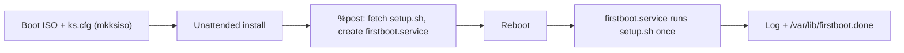

# rocky-homelab

Unattended **Rocky Linux 10.2** install. A Kickstart file is baked into a bootable ISO with `mkksiso`. After the install, a first-boot script hardens the system and logs every step.

## What it does

1. Builds a custom ISO that installs Rocky Linux with no prompts (`ks.cfg`).
2. During install, `%post` downloads `setup.sh` and registers a one-time systemd service (`firstboot.service`).
3. On first boot, `setup.sh` applies updates, hardens SSH, checks SELinux and the firewall, and validates the result.



## Repository layout

| File | Purpose |
|---|---|
| `ks.cfg` | Kickstart file: disks, user, network, packages, base security settings |
| `setup.sh` | First-boot hardening script, run once after the install |

## Build the ISO

Requirements: `mkksiso` (lorax), `xorriso`, and the Rocky 10.2 boot ISO.

```bash
sudo mkksiso --ks ks.cfg Rocky-10.2-x86_64-boot.iso ./auto.iso

# Extract the grub configs so they can be adjusted
xorriso -osirrox on -indev auto.iso \
  -extract /EFI/BOOT/grub.cfg efi-grub.cfg \
  -extract /boot/grub2/grub.cfg bios-grub.cfg

#Skip grub menu with sed edit
sed -i 's/^set timeout=.*/set timeout=5/; s/^set default=.*/set default="0"/' efi-grub.cfg bios-grub.cfg

# Repack the ISO with the edited grub configs
xorriso \
  -indev auto.iso \
  -outdev final_kickstart.iso \
  -boot_image any replay \
  -map ./efi-grub.cfg /EFI/BOOT/grub.cfg \
  -map ./bios-grub.cfg /boot/grub2/grub.cfg
```

Boot a VM from `final_kickstart.iso`. The install runs with no input and reboots into the finished system.

## ks.cfg

| Area | Setting |
|---|---|
| Mode | Text, non-interactive, `en_US.UTF-8`, US keyboard |
| Time | `Europe/Athens`, Greek NTP pool (`0.gr.pool.ntp.org`, `1.gr.pool.ntp.org`) |
| Access | Root locked; `sysadmin` user in `wheel` with an SSH public key |
| Source | Rocky 10.2 BaseOS and AppStream from `dl.rockylinux.org` |
| Disk | GPT, `autopart` without LVM, XFS, no separate `/home` |
| Network | DHCP, hostname `rocky99`, DNS `1.1.1.1` |
| Security | SELinux enforcing; firewall enabled with SSH only |
| Services | `sshd`, `chronyd`, `auditd`, `NetworkManager`, `rsyslog` |
| Packages | `@^server-product-environment`, `audit`, `rsyslog`, `bash-completion`, `open-vm-tools` |
| `%post` | Downloads `setup.sh` to `/usr/local/sbin/`, creates and enables `firstboot.service` |

`firstboot.service` runs `setup.sh` once. It starts after the network and `firewalld`, writes output to `/var/log/firstboot_script.log`, and creates `/var/lib/firstboot.done` on success so it does not run again. If the script fails, it retries on the next boot.

## setup.sh

| Step | What it does |
|---|---|
| Updates | `dnf upgrade`, installs `dnf-automatic` set to security updates, enables its timer |
| Time | Enables `chronyd`, forces a sync, shows tracking status |
| SSH | Drop-in `00-hardening.conf`: no root login, `MaxAuthTries 3`, `wheel` only. Password login is turned off only if `sysadmin` has an authorized key |
| SELinux | Confirms Enforcing, fixes Permissive, fails if Disabled |
| Firewall | Allows SSH, removes `cockpit` |
| Logging | Enables `auditd`, sets persistent `journald` storage |
| Validation | Checks that services are active, prints SELinux status, notes whether a reboot is needed |

The script uses `set -euo pipefail`, so a failed step stops it instead of continuing silently.

## Verify after install

```bash
systemctl status firstboot
cat /var/log/firstboot_script.log
ls /var/lib/firstboot.done
sshd -T | grep -E 'permitrootlogin|passwordauthentication|allowgroups'
getenforce
systemctl list-timers | grep dnf
```

Reboot once and check that the log shows no second run.

## Screenshots
After making the Final Kickstart iso I plugged it in a VM with a 23GB SATA disk, 2.6GB RAM and 4 CPU cores along with NAT

Hands-Free Installation


Script is Enabled

This is the Script that was downloaded from the kickstart %post-%end curl


My public SSH key was automatically added from the kickstart. (Watch out with ssh and kickstart because you could lock yourself out)


These are the hardening script's logs


Now lets install and configure automated backups with Restic!


This is the script in /usr/local/sbin/


## Before you use it

- Replace the SSH public key and the `--password` hash in `ks.cfg` with your own. Generate a hash with `openssl passwd -6`. Never commit a real password hash.
- `setup.sh` is fetched from the `main` branch for simplicity. For production, pin it to a commit with a checksum, or use `ansible-pull` with signed commits.
