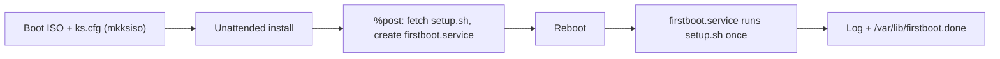

# rocky-homelab

Unattended **Rocky Linux 10.2** install. A Kickstart file is baked into a bootable ISO with `mkksiso`. After the install, a first-boot script hardens the system and logs every step.

## What it does

1. Builds a custom ISO that installs Rocky Linux with no prompts (`ks.cfg`).
2. During install, `%post` downloads `setup.sh` and registers a one-time systemd service (`firstboot.service`).
3. On first boot, `setup.sh` applies updates, hardens SSH, checks SELinux and the firewall, and validates the result.



## Repository layout

| File | Purpose |
|---|---|
| `ks.cfg` | Kickstart file: disks, user, network, packages, base security settings |
| `setup.sh` | First-boot hardening script, run once after the install |
| `backup.sh` | A backup script that selects what to include in a backup, logs it and then hands it over to restic |

## Build the ISO

Requirements: `mkksiso` (lorax), `xorriso`, and the Rocky 10.2 boot ISO.

```bash
sudo mkksiso --ks ks.cfg Rocky-10.2-x86_64-boot.iso ./auto.iso

# Extract the grub configs so they can be adjusted
xorriso -osirrox on -indev auto.iso \
  -extract /EFI/BOOT/grub.cfg efi-grub.cfg \
  -extract /boot/grub2/grub.cfg bios-grub.cfg

#Skip grub menu with sed edit
sed -i 's/^set timeout=.*/set timeout=5/; s/^set default=.*/set default="0"/' efi-grub.cfg bios-grub.cfg

# Repack the ISO with the edited grub configs
xorriso \
  -indev auto.iso \
  -outdev final_kickstart.iso \
  -boot_image any replay \
  -map ./efi-grub.cfg /EFI/BOOT/grub.cfg \
  -map ./bios-grub.cfg /boot/grub2/grub.cfg
```

Boot a VM from `final_kickstart.iso`. The install runs with no input and reboots into the finished system.

## ks.cfg

| Area | Setting |
|---|---|
| Mode | Text, non-interactive, `en_US.UTF-8`, US keyboard |
| Time | `Europe/Athens`, Greek NTP pool (`0.gr.pool.ntp.org`, `1.gr.pool.ntp.org`) |
| Access | Root locked; `sysadmin` user in `wheel` with an SSH public key |
| Source | Rocky 10.2 BaseOS and AppStream from `dl.rockylinux.org` |
| Disk | GPT, `autopart` without LVM, XFS, no separate `/home` |
| Network | DHCP, hostname `rocky99`, DNS `1.1.1.1` |
| Security | SELinux enforcing; firewall enabled with SSH only |
| Services | `sshd`, `chronyd`, `auditd`, `NetworkManager`, `rsyslog` |
| Packages | `@^server-product-environment`, `audit`, `rsyslog`, `bash-completion`, `open-vm-tools` |
| `%post` | Downloads `setup.sh` to `/usr/local/sbin/`, creates and enables `firstboot.service` |

`firstboot.service` runs `setup.sh` once. It starts after the network and `firewalld`, writes output to `/var/log/firstboot_script.log`, and creates `/var/lib/firstboot.done` on success so it does not run again. If the script fails, it retries on the next boot.

## setup.sh

| Step | What it does |
|---|---|
| Updates | `dnf upgrade`, installs `dnf-automatic` set to security updates, enables its timer |
| Time | Enables `chronyd`, forces a sync, shows tracking status |
| SSH | Drop-in `00-hardening.conf`: no root login, `MaxAuthTries 3`, `wheel` only. Password login is turned off only if `sysadmin` has an authorized key |
| SELinux | Confirms Enforcing, fixes Permissive, fails if Disabled |
| Firewall | Allows SSH, removes `cockpit` |
| Logging | Enables `auditd`, sets persistent `journald` storage |
| Validation | Checks that services are active, prints SELinux status, notes whether a reboot is needed |

The script uses `set -euo pipefail`, so a failed step stops it instead of continuing silently.

## Verify after install

```bash
systemctl status firstboot
cat /var/log/firstboot_script.log
ls /var/lib/firstboot.done
sshd -T | grep -E 'permitrootlogin|passwordauthentication|allowgroups'
getenforce
systemctl list-timers | grep dnf
```

Reboot once and check that the log shows no second run.

## Screenshots
After making the Final Kickstart iso I plugged it in a VM with a 23GB SATA disk, 2.6GB RAM and 4 CPU cores along with NAT

# Automated Hardening & Backup Pipeline

A streamlined setup for hands-free OS installation, automated system hardening, and secure local backups using Restic.

---

## 1. Hands-Free Installation & Kickstart

The installation process is fully automated via Kickstart. During the `%post` phase, configuration scripts are fetched and executed automatically, including setting up your public SSH key for secure remote access.

> **Note:** Always double-check your SSH configurations during kickstart deployments to prevent accidental lockouts.

| Hands-Free Setup | Post-Install Script Execution |
| :---: | :---: |
|  |  |

* **Script Status:** Active and executing via curl payload in the kickstart `%post-%end` block.
* **SSH Integration:** Automated injection of authorized public keys.

---

## 2. System Hardening Logs

Once the system boots, the hardening script runs to lock down the environment. Below are sample execution logs showing the hardening tasks being applied:


---

## 3. Automated Backups with Restic

Backups are handled via **Restic**, configured to run seamlessly on the system.

### Installation & Initialization
```bash
# Install Restic
dnf install restic -y # or your package manager equivalent

# Initialize the backup repository
restic init -r /opt/backups/my-repo
```

### Backup Script (`/usr/local/sbin/backup.sh`)
The custom backup script handles repository snapshots and cleanup:


### Manual Execution & Verification
Running the backup script manually confirms snapshots are successfully created and stored:


### Restoring from Backup
To restore your system or files from the latest snapshot, run:

```bash
restic -r /opt/backups/my-repo restore latest --target /
```
